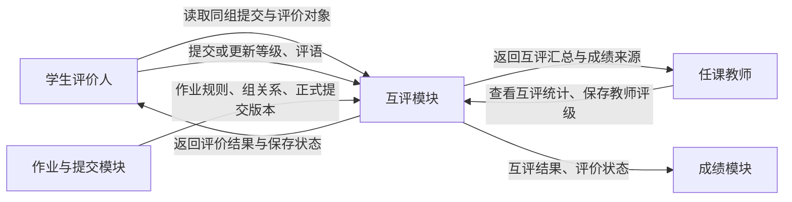
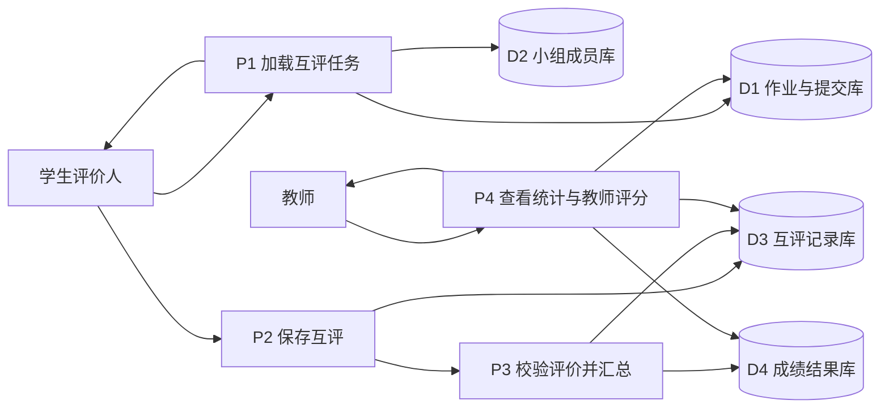
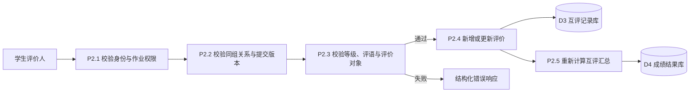
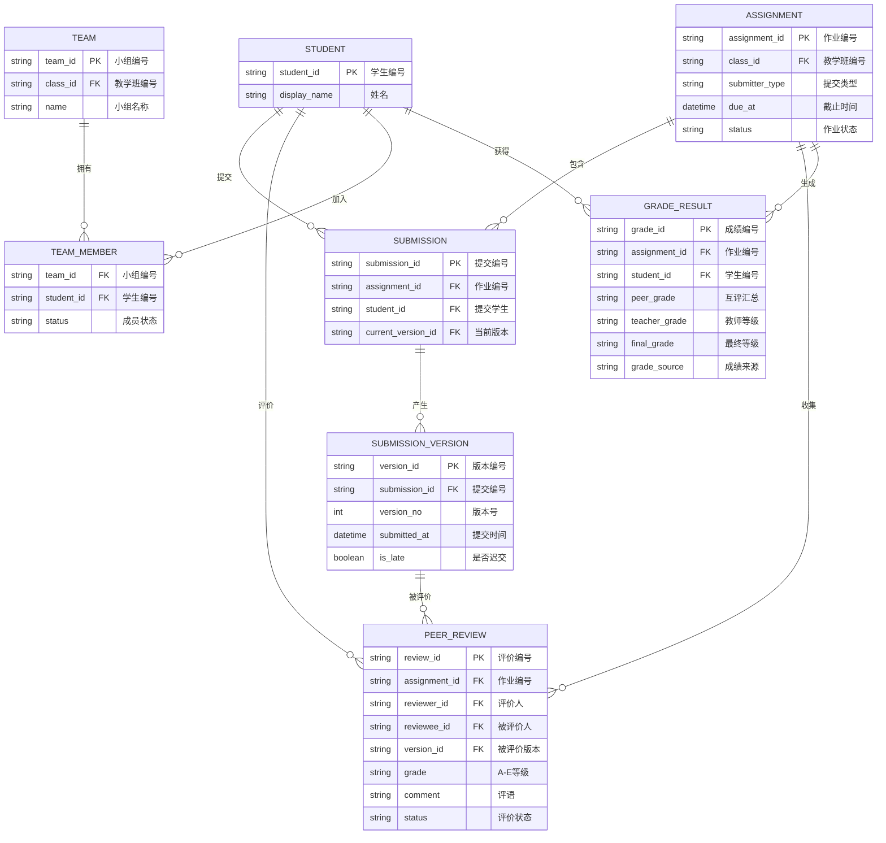
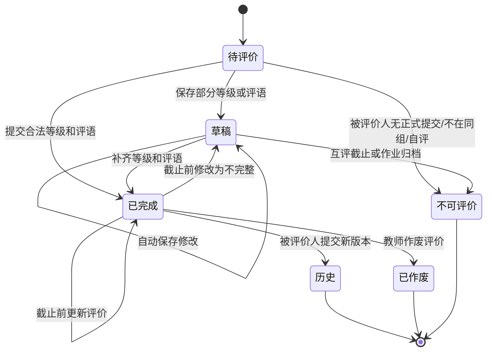

# 软件工程作业系统互评模块需求规格说明书

> 课程：软件工程　|　模块：个人作业组内互评　|　版本：V1.0
>
> 本章按“需求获取—功能需求—数据需求—行为需求—非功能需求”编写，聚焦当前系统的个人作业组内互评主流程。历史的一对一、百分制互评接口只作为兼容数据读取，不作为本章新流程。

## 2.1 需求获取（业务描述）

**甲方原话（待访谈确认）**：

> “学生完成个人作业后，希望同组成员能看到最新提交并给出等级和意见；教师需要能够查看互评结果，必要时用自己的评分覆盖互评结果。”

以上内容是依据当前项目需求和接口实现整理的业务假设，需向任课教师和学生代表确认评价开放时间、评语要求、是否实名展示以及成绩申诉规则。

**业务描述**：互评模块服务于个人作业。学生先在作业中完成正式提交；同组其他成员可以查看该学生的最新正式提交，并提交 A、B、C、D、E 五档评级及评语。系统禁止评价自己、跨组评价或评价尚未正式提交的学生。被评价学生产生新版本后，旧版本评价保留为历史记录，新版本需要重新评价。教师可以查看提交和互评情况，并对最新正式提交保存可选的 A–E 教师评级。

**成绩规则**：A、B、C、D、E 分别换算为 5、4、3、2、1 分，系统对当前正式提交收到的有效互评求平均并四舍五入回 A–E。若存在教师评级，最终等级采用教师评级；没有教师评级但存在有效互评时采用互评汇总；两者都没有时保持待评分。截止后未提交的学生显示系统 E；允许迟交并补交后，系统 E 撤销并重新计算。

**本章示范范围**：选取“学生评价同组成员最新个人提交”这一条主流程展开到数据字典、E-R 图和状态图；教师覆盖评分、成绩导出和历史兼容读取只在系统级功能中定位，不展开为独立状态图。

## 2.2 功能需求（DFD + 数据字典）

### 2.2.1 0 层数据流图（系统上下文图）

0 层图只描述模块边界及外部交互，不展开内部校验。互评模块的关键输入是作业、教学班、小组关系和正式提交版本；关键输出是评价记录、互评汇总及成绩来源。

### 2.2.2 1 层数据流图（模块主要功能）

系统内部分解为四个处理：**P1 加载互评任务、P2 保存互评、P3 校验评价并汇总、P4 教师查看统计与评分**；四个数据存储分别保存提交版本、小组关系、互评记录和成绩结果。P3 同时读取并写入互评记录，写入成绩结果，避免只保存评价而无法形成成绩。

### 2.2.3 2 层数据流图（P2“保存互评”分解）

“自评、跨组、未提交、等级非法、截止后写入”等判断在 P2.3 中完成；它们是否允许状态继续变化，在 2.4 节状态图中表达。DFD 只描述数据流，不把每个判断画成外部实体或流程菱形。

### 2.2.4 数据字典

**数据流条目**

| 数据流 | 定义 |
|---|---|
| 互评任务 | 互评任务 = 作业编号 + 被评价学生编号 + 最新提交版本 + 文件清单 + 当前评价 + 评价状态 |
| 互评提交 | 互评提交 = 评价人编号 + 被评价学生编号 + 提交版本编号 + 等级 + 评语 + 客户端版本号 |
| 互评汇总 | 互评汇总 = 作业编号 + 被评价学生编号 + 有效评价数量 + 平均等级值 + 汇总等级 |
| 教师评分 | 教师评分 = 教师编号 + 被评价学生编号 + 提交版本编号 + A–E 等级 + 可选评语 |

**数据存储条目**

| 数据存储 | 定义 |
|---|---|
| D1 作业与提交库 → 正式提交版本 | 正式提交版本 = 提交编号 + 作业编号 + 学生编号 + 版本号 + 提交时间 + 迟交标记 + `{ 文件编号 + 原始文件名 }` |
| D2 小组成员库 → 有效成员关系 | 有效成员关系 = 教学班编号 + 小组编号 + 学生编号 + 成员状态 |
| D3 互评记录库 → 互评记录 | 互评记录 = 评价编号 + 作业编号 + 评价人编号 + 被评价人编号 + 提交版本编号 + 等级 + 评语 + 状态 + 创建/更新时间 |
| D4 成绩结果库 → 成绩结果 | 成绩结果 = 作业编号 + 学生编号 + 互评汇总 + 教师评级 + 最终等级 + 成绩来源 + 评分状态 |

`{ }` 表示重复组：一个正式提交版本可以关联多个文件。互评记录必须保存 `submission_version_id`，不能只保存学生编号，否则学生重新提交后无法判断评价针对哪一版作品。

## 2.3 数据需求（E-R 图）

**实体来源**：ASSIGNMENT、SUBMISSION、SUBMISSION_VERSION 来自作业和提交数据；TEAM、TEAM_MEMBER 来自组内权限校验；PEER_REVIEW 来自 D3 互评记录；GRADE_RESULT 来自 D4 成绩结果。文件明细属于提交版本的重复组，本章不展开 FILE_OBJECT。

**关系基数**：一个作业可以有多名学生提交；一个提交可以产生多个版本；一个正式提交版本可以收到多条互评；一个学生可以评价多个同组成员，但不能评价自己；一名学生在一个教学班内只能有一个有效小组成员关系。`PEER_REVIEW` 使用评价人、被评价人、作业和版本共同确定评价上下文，同一评价人对同一版本只保留一条有效评价。

## 2.4 行为需求（状态图）

数据字典中 `PEER_REVIEW` 有 `status` 字段，因此需要画状态图。`SUBMISSION_VERSION` 的生命周期属于作业提交模块；`GRADE_RESULT` 的发布和修改属于成绩模块，本章只表现互评对它的影响。

其中“被评价人提交新版本”是异常与版本分支：旧评价不删除，但不再用于新版本成绩；新版本重新进入待评价。作业截止或教学班归档后，学生不能继续保存互评。教师评分存在时，最终成绩从互评汇总切换为教师等级；教师评分清除后，若仍有有效互评，则回退到互评汇总。

## 2.5 非功能需求

| 类别 | 要求 | 依据 |
|---|---|---|
| 权限 | 学生只能读取自己所属教学班、自己所在小组及服务端判定可评价的同组正式提交；不能通过修改 `reviewee_id` 跨组评价 | 当前互评接口的班级、小组和评价对象校验 |
| 一致性 | 同一评价人对同一提交版本最多一条有效评价；重复提交应更新或幂等返回，不生成重复记录 | `peer_reviews` 唯一约束与接口规则 |
| 可追溯性 | 每条评价必须绑定作业、评价人、被评价人和提交版本，并保留创建、更新时间及历史状态 | 新版本需要重新评价，旧版本评价保留 |
| 安全性 | 文件预览与下载必须继续经过提交主体、教学班、小组和评价关系授权；评语、Cookie、CSRF Token 不写入普通日志 | 项目会话、文件和审计安全约束 |
| 可用性 | 评价页面应显示被评价学生、提交版本、附件、当前等级、评语和保存状态；保存失败时不得显示为已保存 | 当前互评工作台和自动保存需求 |
| 并发 | 多次快速保存同一评价时，服务端按版本或请求顺序处理，不能用旧请求覆盖新内容 | 评价草稿自动保存与版本字段要求 |
| 成绩正确性 | A–E 汇总按 5～1 分平均并四舍五入；教师评级优先；无评价时显示待评分；截止未交显示系统 E | 当前成绩接口规则 |
| 性能 | 常规互评任务列表和评价保存应在普通教学负载下及时返回；具体响应目标、班级人数和并发提交量待向教师确认 | 目前缺少真实班级规模和服务器压测数据 |
| 兼容性 | 个人作业支持互评；小组作业不得进入当前组内个人互评流程；历史一对一数据可读取 | 当前实现覆盖清单 |

## 写这一章时最容易踩的坑（自查用）

- 互评对象必须来自服务端小组关系和正式提交，不接受客户端任意传入对象后直接评价。
- “同组”是权限条件，不等于可以评价自己；必须单独校验 `reviewer_id != reviewee_id`。
- 评价必须绑定提交版本。学生重新提交后，旧评价不能直接套用到新版本。
- DFD 画数据流，等级合法性、自评、跨组和截止判断放到行为需求与状态图说明。
- E-R 图中的 PEER_REVIEW 不是成绩本身；成绩结果还需要记录互评汇总、教师评级、最终等级和成绩来源。
- 非功能需求要有依据；没有真实并发数据时，性能指标应写“待确认”，不能凭空编造数字。
